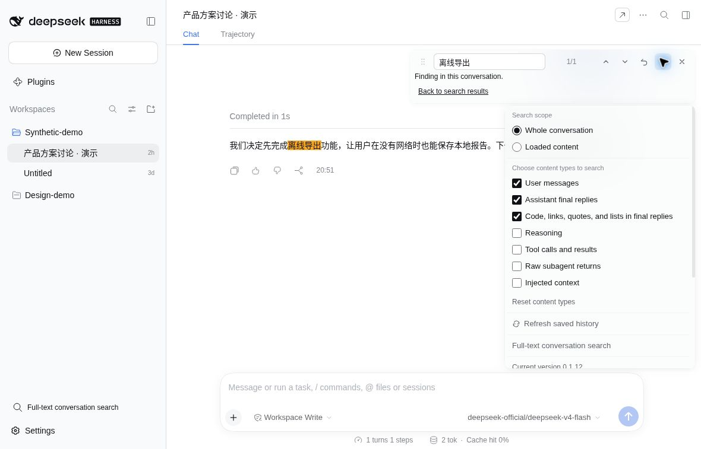

# dsh-find-all

DeepSeek Harness（DSH）的对话查找插件。搜索各工作区对话的标题和已保存正文，也可按 **⌘F / Ctrl+F** 查找当前对话。

## 效果预览

记得聊过「离线导出」，却忘了在哪个对话？输入关键词，从正文片段中找回它。

## 安装

1. 打开 DSH 的「插件」→「添加插件」。
2. 输入 `@ryuu-64/dsh-find-all`，安装并启用。
3. 重启 DSH（网页版需重启服务并刷新页面）。

如果装过 `dsh-find-bar`，请先卸载，避免快捷键冲突。支持的宿主与功能范围见[兼容说明](docs/compatibility.md)。

## 使用

### 查找其他对话

1. 点侧栏「对话全文搜索」，输入关键词，无需先打开聊天。默认同时搜索标题和正文；只记得标题时可勾选「仅标题」。
2. 从结果的标题、工作区和正文片段中找到目标。一页满后，点「继续加载结果」。想找已归档的聊天，勾选「包含归档」。
3. 点结果打开对话，继续用同一关键词查找。归档结果需主动点「取消归档并打开」；点「返回搜索结果」可回到原查询和列表位置。

搜索会分批显示结果，并区分尚未搜完、读取失败、已停止和确实没有结果。查询期间有新增或改动的内容，可在搜索框按 `Enter` 重新搜索。

### 查找当前对话

- **打开查找**：按 `⌘F / Ctrl+F`，输入关键词。
- **切换结果**：按 `Enter` / `Shift+Enter`；也可点击结果数量，输入序号后按 `Enter` 跳转。
- **停止搜索**：点查找栏里正在搜索的状态提示。
- **关闭查找**：按 `Esc`；选项展开时会先收起选项。

例如，输入「离线导出」后切换到下一处，查看高亮的正文。

### 搜索选项

点查找栏的 `⋯` 打开菜单：

- 切换「完整会话 / 已加载内容」，或勾选思考、工具等内容。默认搜索用户消息和助手回复。
- 点「重新读取最新会话历史」，搜索刚收到的新消息。
- 进入「对话全文搜索」，带上当前关键词寻找其他对话。
- 点「检查更新」查看新版；有新版时，在 DSH「插件」页卸载后重新安装并重启。
- 点「复制诊断信息」准备问题反馈，或点「关于」查看作者和项目链接。

## 搜索范围与限制

- **跨对话搜索**只查当前连接的 DSH 服务中、所有工作区的普通对话。默认不含归档；查看归档命中不会自动恢复对话。
- **正文范围**是已保存的用户消息和助手已完成的正文，包括压缩前仍可阅读的历史。不搜索工具、思考过程、子代理、附件、图片文字或未发送草稿。
- **匹配方式**是忽略大小写的字面子串，支持中文短词、英文和代码片段。跨对话匹配保存的原始 Markdown 文本，跨格式标记的渲染后短语不保证匹配；打开摘要也不保证直接跳到原句。
- **历史与结果**：首次跨对话搜索需逐个读取会话，大型历史可能较慢；极大或无法读取的会话会提示未完整搜索。当前对话的「完整会话」搜索已保存消息，无法使用时可改选「已加载内容」；不搜索图片文字或附件内容，最多显示前 5000 个结果，没搜完或无法准确跳转时会提示。
- **隐私与配置**：搜索不改聊天记录，不把搜索词或正文发送到外部 AI；浏览器只接收匹配片段。无需开启 SQLite 全文索引，也不建立持久正文索引或改变宿主默认配置。宿主缺少跨对话搜索所需接口时会提示服务不可用，原有会话内查找仍可使用。

跨对话搜索的详细说明也可在搜索面板的「搜索说明」中查看。

## 反馈与交流

遇到问题请[到 GitHub 反馈](https://github.com/Ryuu-64/dsh-find-all/issues/new)，说明你做了什么、遇到什么问题，附上必要截图。可点 `⋯` →「复制诊断信息」后粘贴到反馈中。不要公开密钥或私密对话。

QQ 交流群：**1129212995**。需要跟进的问题请到 GitHub 反馈。

## 作者与致谢

由 [Ryuu-64](https://github.com/Ryuu-64) 维护，基于 [secyborg/dsh-find-bar](https://github.com/secyborg/dsh-find-bar) 开发，感谢 secyborg 的原作。

[MIT 许可](LICENSE)：Copyright (c) 2026 secyborg / Copyright (c) 2026 Ryuu-64。
上游 README 见 [README.fork-origin.md](README.fork-origin.md)，改动与致谢见 [NOTICE.md](NOTICE.md)。
