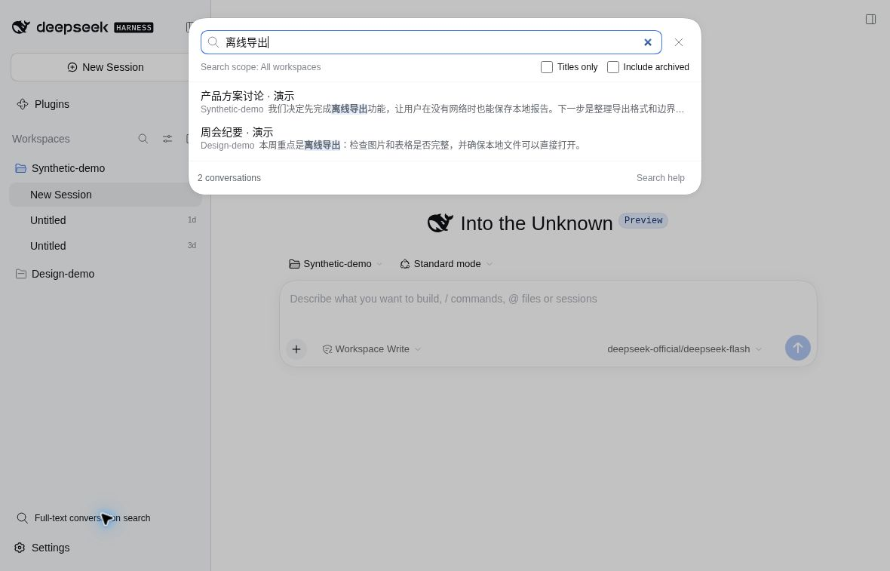
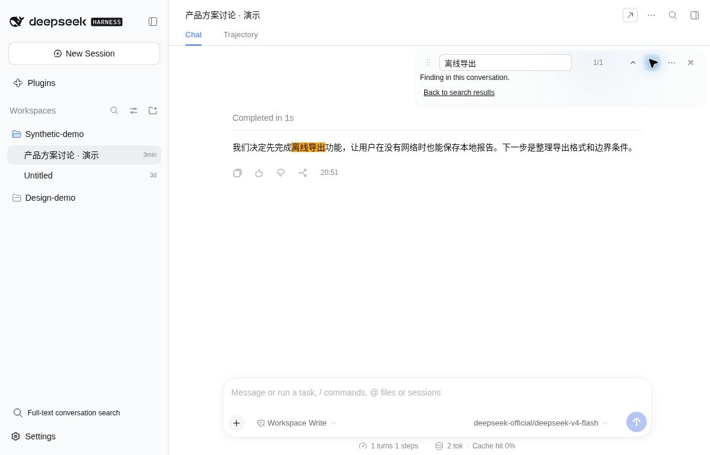

# dsh-find-all

DeepSeek Harness（DSH）的对话查找插件。按 **⌘F / Ctrl+F** 查找当前对话；点侧栏的「对话全文搜索」寻找其他对话。

## 安装

1. 打开 DSH 的「插件」→「添加插件」。
2. 输入 `@ryuu-64/dsh-find-all`，安装并启用。
3. 重启 DSH（网页版需重启服务并刷新页面）。

如果装过 `dsh-find-bar`，请先卸载，避免快捷键冲突。

## 试一下

- **找以前聊过的内容**：点侧栏「对话全文搜索」，输入记得的词，比如「离线导出」，从正文片段中找回目标对话。
- **找归档对话**：勾选「包含归档」；想继续聊天时，点「取消归档并打开」。
- **查当前对话**：按 `⌘F / Ctrl+F`，输入「离线导出」，按 `Enter` / `Shift+Enter` 切换命中。

以下截图使用示例对话，不含真实用户聊天。

打开结果后，可继续用查找栏切换命中；下图是在点击下一处后高亮的结果。

## 使用

- **打开查找**：按 `⌘F / Ctrl+F`，输入关键词。
- **切换结果**：按 `Enter` / `Shift+Enter`；也可点击结果数量，输入序号后按 `Enter` 跳转。
- **调整搜索**：点 `⋯`，切换「完整会话 / 已加载内容」，或勾选思考、工具等内容。默认搜索用户消息和助手回复。
- **搜索新消息**：点 `⋯` →「重新读取最新会话历史」。
- **停止搜索**：点查找栏里正在搜索的状态提示。
- **关闭查找**：按 `Esc`；选项展开时会先收起选项。

「完整会话」搜索已保存的消息；如果无法使用，可改选「已加载内容」。不搜索图片里的文字或附件内容。最多显示前 5000 个结果；没搜完或无法准确跳转时会提示。

## 对话全文搜索

点侧栏的「对话全文搜索」，无需先打开聊天。也可从当前查找栏的 `⋯` 进入，并带上关键词。

默认同时搜索标题和正文，也可勾选「仅标题」。范围是当前连接服务中、所有工作区的普通对话，默认不含归档；勾选「包含归档」后可查看归档命中及正文摘要，主动点击「取消归档并打开」才会恢复并打开。正文直接使用宿主公开的已保存历史读取能力，不要求开启 SQLite 全文索引，也不改变宿主的默认配置。

输入中文短词、英文或代码片段即可按字面子串查找，不区分大小写。结果显示标题、工作区和真实正文片段；标题和片段中的命中会高亮。输入后会自动分批扫描并逐步显示结果；一页结果满后，点击「继续加载结果」查看更多。正文结果不会被标题结果挤掉。界面会区分尚未搜完、读取失败、已停止和确实没有结果。

点击结果会打开该对话，带上关键词继续会话内查找；「返回搜索结果」保留查询和列表位置。摘要不承诺直接跳到原句。跨对话匹配的是保存的文本块，含原始 Markdown；跨格式标记的渲染后短语不保证匹配。详细范围和限制可在「搜索说明」查看。

普通用户消息和助手已完成的正文包括压缩前仍可阅读的历史；不搜索工具、思考过程、子代理、附件、图片文字或未发送草稿。每次查询固定候选对话，期间新增或改动的内容可在输入框按 Enter 重新搜索。极大或无法读取的会话会显示未完整搜索，不会冒充零命中。

搜索只使用当前连接的 DSH 服务，不改聊天记录，不把搜索词或正文发送到外部 AI。浏览器只接收匹配片段；插件不建持久正文索引。首次搜索需要逐个读取会话，大型历史可能较慢。当前宿主缺少所需公开接口时会提示服务不可用，原有会话内查找仍可使用。

## 更新

在 `⋯` 中点「检查更新」。有新版时，去 DSH「插件」页卸载本插件，再按上面的步骤重新安装并重启 DSH。

## 反馈与交流

遇到问题请[到 GitHub 反馈](https://github.com/Ryuu-64/dsh-find-all/issues/new)，说明你做了什么、遇到什么问题，附上必要截图。可点 `⋯` →「复制诊断信息」后粘贴到反馈中。不要公开密钥或私密对话。

QQ 交流群：**1129212995**。需要跟进的问题请到 GitHub 反馈。

点 `⋯` →「关于」可查看作者、联系方式与项目链接。

## 作者与致谢

由 [Ryuu-64](https://github.com/Ryuu-64) 维护，基于 [secyborg/dsh-find-bar](https://github.com/secyborg/dsh-find-bar) 开发，感谢 secyborg 的原作。

[MIT 许可](LICENSE)：Copyright (c) 2026 secyborg / Copyright (c) 2026 Ryuu-64。
上游 README 见 [README.fork-origin.md](README.fork-origin.md)，改动与致谢见 [NOTICE.md](NOTICE.md)。
