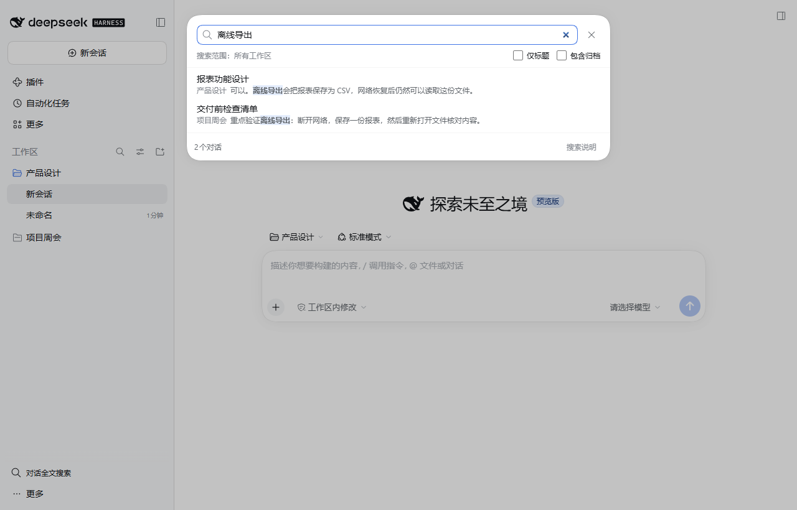
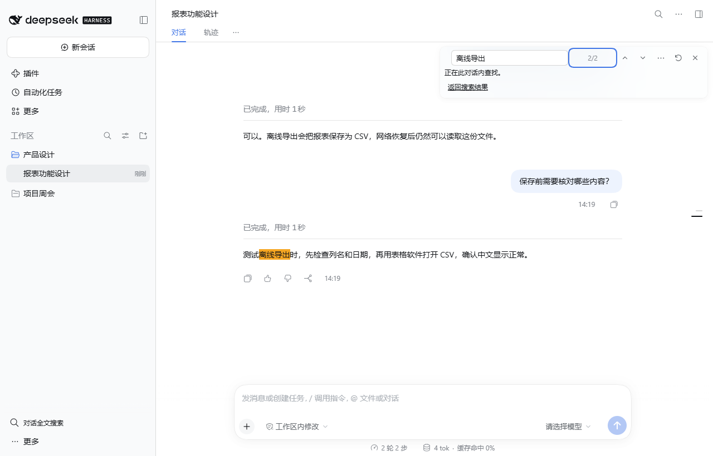
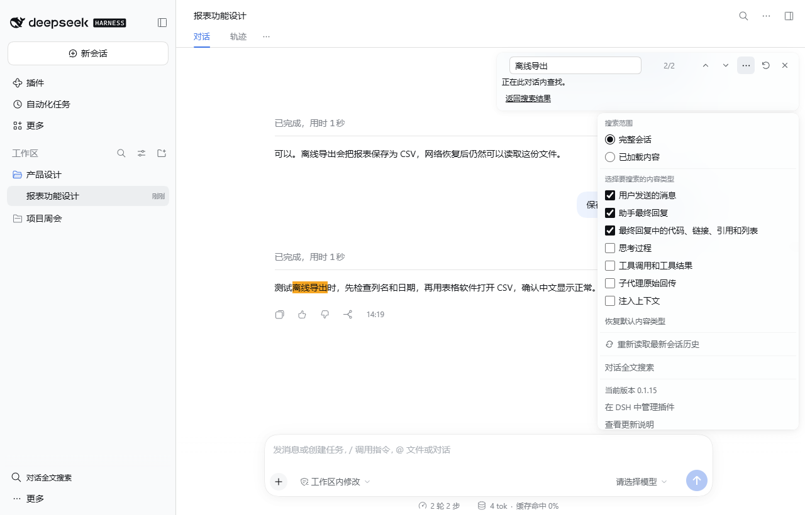

# dsh-find-all for DeepSeek Harness

English | [简体中文](https://github.com/Ryuu-64/dsh-find-all/blob/main/README.zh-CN.md)

Search conversation titles and saved messages across workspaces in DeepSeek Harness (DSH), or press **⌘F / Ctrl+F** to find text in the current conversation.

## Preview

Remember discussing offline export but can't remember which conversation? Search for `离线导出` (offline export) and use the message excerpts to find it.



The screenshots show the source build running on DSH `0.2.2-rc.3` Web in Chinese, with sample conversations.

## Versions and installation

The latest npm release, **`0.1.15`**, supports selected DSH versions through **`0.2.1-rc.3`**. For DSH **`0.2.2-rc.3` Web**, use the source installation below. Features marked **source build** are available from the repository.

If you have `dsh-find-bar` installed, remove it first to avoid a shortcut conflict.

### Install the npm release

1. In DSH, go to **Plugins** and choose **Add plugin**.
2. Enter `@ryuu-64/dsh-find-all`, then install and enable it.
3. Restart DSH. On Web, restart the server and refresh the page.

### Install the source build on DSH 0.2.2-rc.3 Web

On the machine running the DSH Web server, use Node.js 24 (`24.9.0` or later) and make sure `git`, `npm`, `pnpm`, and `dsh` are available in your terminal. The repository includes the built `lib/` files, so you can pack it directly.

```sh
git clone https://github.com/Ryuu-64/dsh-find-all.git
cd dsh-find-all
npm pack --ignore-scripts --pack-destination "$HOME"
dsh plugin --profile web add "$HOME/ryuu-64-dsh-find-all-0.1.15.tgz" --ignore-scripts
```

Keep the `.tgz` file because the profile references it. If you use a custom Web profile, replace `web` with its name. Restart that same profile with your usual Web start command, then refresh the browser.

## Go from search results to the message

1. Open **Full-text conversation search** in the sidebar and enter `离线导出`. The results show titles, workspaces, and message excerpts.
2. Select **报表功能设计** (Report feature design). The conversation opens with the same query in the find bar. The highlight can land in a different place from the excerpt in the search results.
3. Click the match count, enter `2`, and press `Enter` to jump to the second match. **Back to search results** restores your query and position in the list.



If the conversation is already open, press `⌘F / Ctrl+F`. Use `Enter` or `Shift+Enter` to move between matches and `Esc` to close the find bar.

## Search options and limits

- **Across workspaces**, select **Titles only** or **Include archived** to change what you search. Select **Load more results** if the search has more conversations to scan. Use **Unarchive and open** to open an archived conversation. Press `Enter` in the search field to rerun the search after conversations change.
- **In the current conversation**, the default search includes user messages and assistant replies. Open `⋯` to choose **Whole conversation** or **Loaded content**, or add content types such as reasoning and tool calls. Use **Loaded content** when whole-conversation search is unavailable.
- **Save search defaults (source build)** on a DSH host that supports plugin configuration forms. Open this plugin under **Plugins** in the sidebar and select **Configure** on its component row. You can set titles-only search and archived inclusion for that profile. The defaults apply the next time you open full-text search.



<a id="更新" name="更新"></a>

### Updating

In the npm release `0.1.15`, open `⋯` in the find bar and choose **Check for updates**. To update manually, uninstall the plugin in the active profile, then use **Plugins** to install a published release compatible with your DSH version. Restart if DSH prompts you to.

In the source build, `⋯` → **Manage plugin in DSH** opens the plugin details. If your host shows **Versions** for an npm installation, choose **Check again** to see compatible releases.

### What gets searched and where

- Cross-conversation search covers ordinary conversations on the connected DSH server. It searches saved user messages and completed assistant text as case-insensitive literal text in the original Markdown. Reasoning, tools, subagent conversations, attachments, and text inside images are outside its scope.
- Long histories can take time to scan. The results tell you when a scan is incomplete or some conversations could not be read. In-conversation find shows up to 5,000 matches.
- Search is read-only and keeps queries and messages within DSH. For cross-conversation search, the DSH server scans the messages and sends matching excerpts and conversation details to the browser. Whole-conversation find reads the history of the current conversation in the browser.

## Feedback and documentation

[Report an issue on GitHub](https://github.com/Ryuu-64/dsh-find-all/issues/new) with steps to reproduce the problem and any relevant screenshots. You can use `⋯` → **Copy diagnostics** to include troubleshooting details. Keep API keys and private conversations out of public issues.

The QQ group is **1129212995**. For search behavior, see **Search help** in the search dialog. For supported versions and tested platforms, see the [compatibility notes](https://github.com/Ryuu-64/dsh-find-all/blob/main/docs/compatibility.md).

## Credits

Maintained by [Ryuu-64](https://github.com/Ryuu-64). Based on [secyborg/dsh-find-bar](https://github.com/secyborg/dsh-find-bar), with thanks to secyborg for the original plugin.

[MIT License](https://github.com/Ryuu-64/dsh-find-all/blob/main/LICENSE). Copyright (c) 2026 secyborg / Copyright (c) 2026 Ryuu-64.
See the [upstream README (Chinese)](https://github.com/Ryuu-64/dsh-find-all/blob/main/README.fork-origin.md) and [notices and credits](https://github.com/Ryuu-64/dsh-find-all/blob/main/NOTICE.md).
