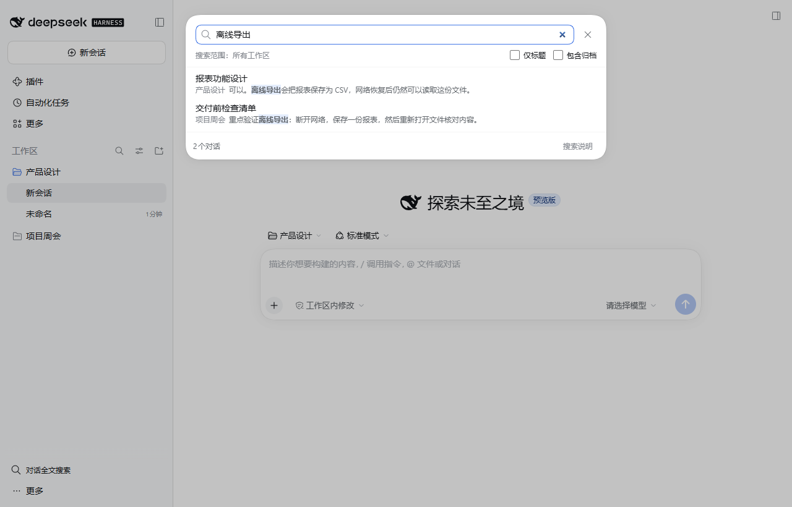
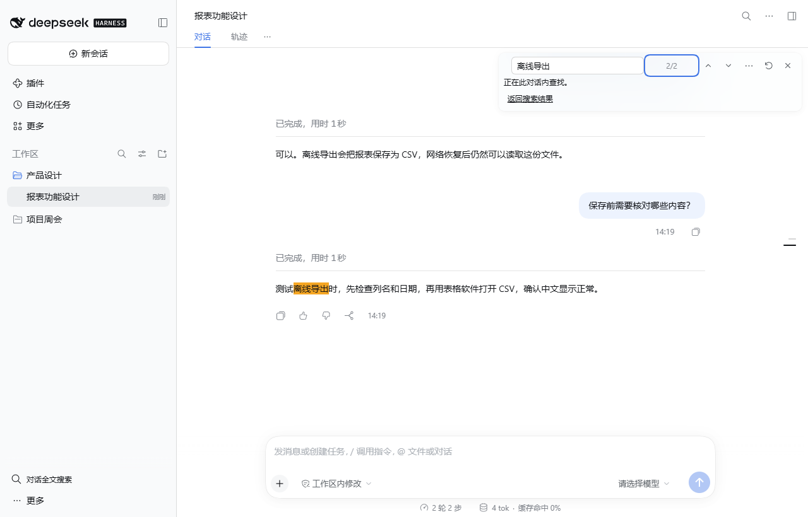
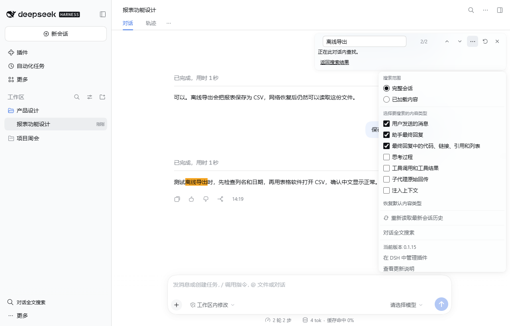

# dsh-find-all 对话全文搜索

[English](https://github.com/Ryuu-64/dsh-find-all/blob/main/README.md) | 简体中文

在 DeepSeek Harness（DSH）中搜索各工作区对话的标题和已保存正文，也可以按 **⌘F / Ctrl+F** 查找当前对话。

## 效果预览

记得聊过「离线导出」，却忘了在哪个对话？输入关键词，从正文片段中找回它。

示例中，两个工作区各有一段对话匹配「离线导出」。

## 安装

可以把下面这条请求发给能操作你电脑的 AI 助手。

> 请帮我安装这个 DSH 插件，检查兼容性并确认已启用：https://github.com/Ryuu-64/dsh-find-all

如果装过 `dsh-find-bar`，请先卸载，避免快捷键冲突。

## 从搜索结果找到原文

1. 点侧栏「对话全文搜索」，输入「离线导出」。标题和正文一起搜索，结果会显示对话标题、工作区和含关键词的正文片段。
2. 点「报表功能设计」。插件会打开对话，并在查找栏里继续查找「离线导出」。打开后的高亮位置可能与搜索摘要不同。
3. 点查找栏的结果数量，输入 `2`，按 `Enter` 定位到第二处。点「返回搜索结果」，可以回到原查询和列表位置。

已经打开目标对话时，直接按 `⌘F / Ctrl+F`。用 `Enter` 和 `Shift+Enter` 切换匹配，按 `Esc` 关闭查找。

## 常用设置与限制

- **跨工作区搜索**可勾选「仅标题」或「包含归档」。结果较多时点「继续加载结果」。要打开归档对话，先点「取消归档并打开」。对话有更新时，在搜索框按 `Enter` 重新搜索。
- **当前对话查找**默认搜索用户消息和助手回复。点 `⋯`，可在「完整会话」与「已加载内容」间切换，也可选思考过程、工具等内容类型。完整会话不可用时，可用「已加载内容」继续查找。
- 要**保存搜索默认值**，从侧栏「插件」打开「对话查找」，再点组件行的「配置」。可为当前配置档设置「默认仅搜索标题」和「默认包含已归档对话」，下次打开全文搜索时生效。

### 更新

在查找栏打开 `⋯`，选择「在 DSH 中管理插件」。如果插件详情显示「版本」，点「重新检查」查看兼容的更新。

### 搜索范围与隐私

- 跨对话搜索只查当前连接的 DSH 服务中的普通对话，覆盖已保存的用户消息和已完成的助手正文。它按原始 Markdown 做字面匹配，不区分大小写，跳过思考、工具、子代理、附件和图片文字。
- 大型历史可能需要等待。未扫完或有读取失败时，结果区会提示。当前对话查找最多显示 5000 处匹配。
- 搜索不改聊天记录，也不把搜索词或正文发给外部 AI。**跨对话搜索**由 DSH 服务扫描正文，浏览器收到的是匹配片段和对应的对话信息。**当前对话的完整会话查找**会读取该对话的历史。

## 反馈与详细文档

遇到问题请[到 GitHub 反馈](https://github.com/Ryuu-64/dsh-find-all/issues/new)，说明你做了什么、遇到什么问题，附上必要截图。可点 `⋯` →「复制诊断信息」后粘贴到反馈中。不要公开密钥或私密对话。

QQ 交流群 **1129212995**。跨对话搜索的规则也可在面板的「搜索说明」中查看。版本与平台细节见[兼容说明](https://github.com/Ryuu-64/dsh-find-all/blob/main/docs/compatibility.md)。

## 作者与致谢

由 [Ryuu-64](https://github.com/Ryuu-64) 维护，基于 [secyborg/dsh-find-bar](https://github.com/secyborg/dsh-find-bar) 开发，感谢 secyborg 的原作。

[MIT 许可](https://github.com/Ryuu-64/dsh-find-all/blob/main/LICENSE)。Copyright (c) 2026 secyborg / Copyright (c) 2026 Ryuu-64。
上游 README 见 [README.fork-origin.md](https://github.com/Ryuu-64/dsh-find-all/blob/main/README.fork-origin.md)，改动与致谢见 [NOTICE.md](https://github.com/Ryuu-64/dsh-find-all/blob/main/NOTICE.md)。
