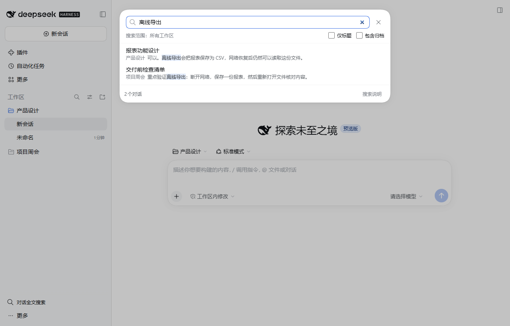
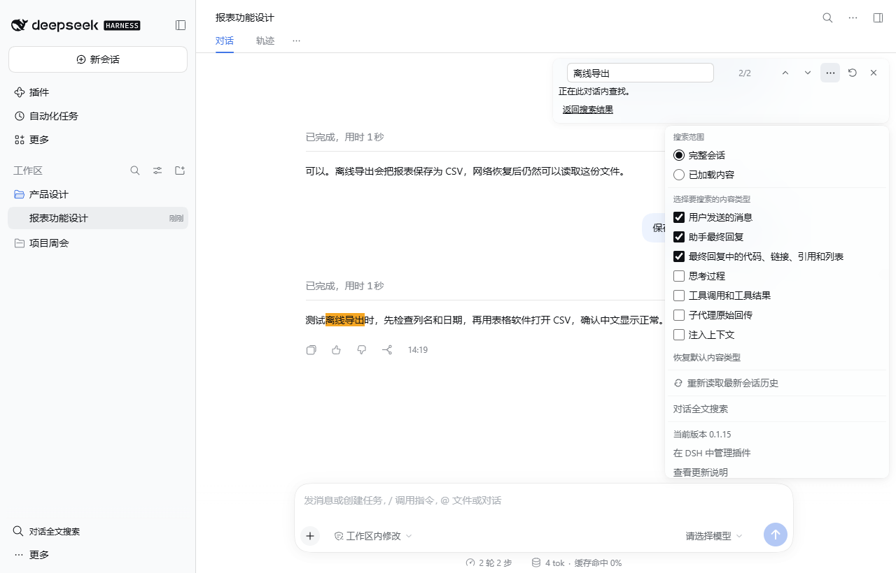

# dsh-find-all 对话全文搜索

[English](https://github.com/Ryuu-64/dsh-find-all/blob/main/README.md) | 简体中文

npm 包：[@ryuu-64/dsh-find-all](https://www.npmjs.com/package/@ryuu-64/dsh-find-all) · 由 [Ryuu-64](https://github.com/Ryuu-64) 维护。 · [插件页面](https://ryuu-64.github.io/dsh/dsh-find-all/)

在 DeepSeek Harness 中跨工作区搜索已保存的对话标题和正文。右栏在切换对话时保留结果，点摘要可直达原文。单个对话里可以用 **⌘F / Ctrl+F** 查找。

## 效果预览

跨工作区搜索 `DOMAIN` 后，可以在右栏浏览结果，同时阅读中间的对话正文。



## 安装

**桌面版**

```sh
dsh plugin --profile desktop add @ryuu-64/dsh-find-all
```

**Web 版**

```sh
dsh plugin --profile web add @ryuu-64/dsh-find-all
```

这套操作适用 DSH `0.2.2-rc.5`。各版本的实测环境和限制见[兼容说明](https://github.com/Ryuu-64/dsh-find-all/blob/main/docs/compatibility.md)。

如已安装 `dsh-find-bar`，请先移除它，避免快捷键冲突。

## 从搜索结果找到原文

1. 点左栏「对话全文搜索」，或在右栏工具里选「搜索」，输入「DOMAIN」。结果显示标题、工作区和正文摘要。
2. 点标题打开对话，点摘要定位到那处命中。切换对话时，右栏保留查询、筛选和列表位置。
3. 窄窗口里，点击结果会收起全屏右栏以显示正文。再次打开搜索可继续浏览。

在没有右栏可用的宿主或页面里，搜索会打开弹窗。弹窗的结果会把关键词带到当前对话查找，可用「返回搜索结果」恢复列表位置。

已经打开目标对话时，直接按 `⌘F / Ctrl+F`。用 `Enter` 和 `Shift+Enter` 切换匹配，按 `Esc` 关闭查找。

「对话全文搜索」默认没有快捷键。想用快捷键时，可在 DSH 的「快捷键」设置里找到「对话全文搜索」并自行绑定。

## 常用设置与限制

- **跨工作区搜索**可勾选「仅标题」或「包含归档」。结果较多时点「继续加载结果」。用结果行上的「取消归档」恢复归档对话。对话有更新时，在搜索框按 `Enter` 重新搜索。
- **当前对话查找**默认搜索用户消息和助手回复。点 `⋯`，可在「完整会话」与「已加载内容」间切换，也可选思考过程、工具等内容类型。完整会话不可用时，可用「已加载内容」继续查找。
- 要**保存搜索默认值**，从侧栏「插件」打开「对话查找」，再点组件行的「配置」。可为当前配置档设置「默认仅搜索标题」和「默认包含已归档对话」，下次打开全文搜索时生效。



### 更新

在查找栏打开 `⋯`，选择「在 DSH 中管理插件」。如果插件详情显示「版本」，点「重新检查」查看兼容的更新。

### 搜索范围与隐私

- 跨对话搜索只查当前连接的 DSH 服务中的普通对话，覆盖已保存的用户消息和已完成的助手正文。它按原始 Markdown 做字面匹配，不区分大小写，跳过思考、工具、子代理、附件和图片文字。
- 大型历史可能需要等待。未扫完或有读取失败时，结果区会提示。当前对话查找最多显示 5000 处匹配。
- 搜索不改聊天记录，也不把搜索词或正文发给外部 AI。**跨对话搜索**由 DSH 服务扫描正文，浏览器收到的是匹配片段和对应的对话信息。**当前对话的完整会话查找**会读取该对话的历史。

## 反馈与详细文档

遇到问题请[到 GitHub 反馈](https://github.com/Ryuu-64/dsh-find-all/issues/new)，说明你做了什么、遇到什么问题，附上必要截图。可点 `⋯` →「复制诊断信息」后粘贴到反馈中。不要公开密钥或私密对话。

QQ 交流群 **1129212995**。跨对话搜索的规则也可在面板的「搜索说明」中查看。版本与平台细节见[兼容说明](https://github.com/Ryuu-64/dsh-find-all/blob/main/docs/compatibility.md)。

## 作者与致谢

由 [Ryuu-64](https://github.com/Ryuu-64) 维护，基于 [secyborg/dsh-find-bar](https://github.com/secyborg/dsh-find-bar) 开发，感谢 secyborg 的原作。

[MIT 许可](https://github.com/Ryuu-64/dsh-find-all/blob/main/LICENSE)。Copyright (c) 2026 secyborg / Copyright (c) 2026 Ryuu-64。
上游 README 见[上游原文](https://github.com/Ryuu-64/dsh-find-all/blob/main/docs/upstream-readme.md)，改动与致谢见 [NOTICE.md](https://github.com/Ryuu-64/dsh-find-all/blob/main/NOTICE.md)。
